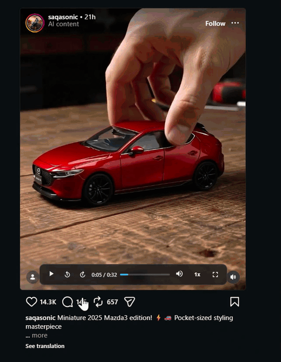
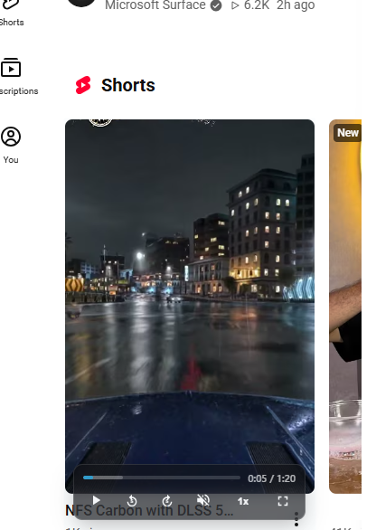
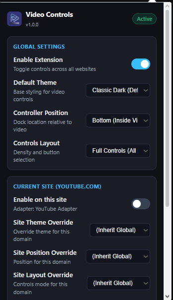
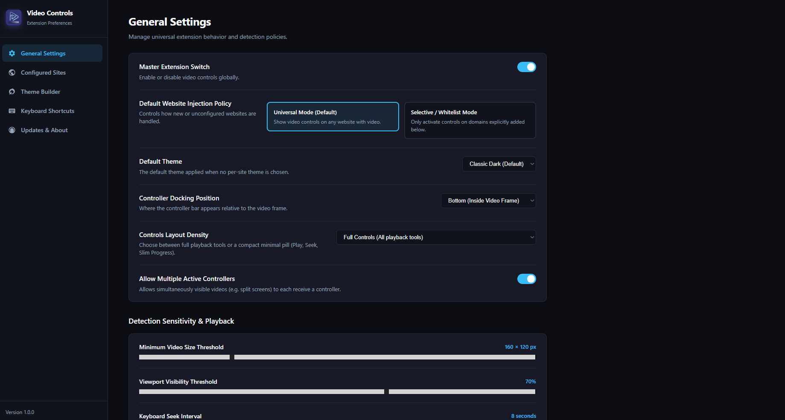

<div align="center">
  
  <h1>OnePlay — Video Control</h1>
  <p><b>A robust, website-independent video controller for HTML5 <code>&lt;video&gt;</code> elements across the web.</b><br>
  Built with Manifest V3 • Immune to overlay click-hijacking, layout modifications, and CSS obfuscation.</p>

  <p>
    <a href="https://chromewebstore.google.com/detail/oneplay-video-control/gpmickcblelmgkfheifkhnhehhmcfahp">
      
    </a>
    
    
  </p>

  <p>
    <a href="https://chromewebstore.google.com/detail/oneplay-video-control/gpmickcblelmgkfheifkhnhehhmcfahp">
      👉 <b>Add to Google Chrome (Official Web Store)</b> 👈
    </a>
  </p>
</div>

---

## 📸 Showcase & Preview

<div align="center">
  
  <p><i>Live demonstration: seamless playback control and stream recording without page interference</i></p>
</div>

<table align="center" width="100%">
  <tr>
    <td align="center" width="50%" valign="top">
      <br>
      <b>Overlay-Immune Video Controller Bar</b>
      <p>Works seamlessly over complex players, Shorts, and social media reels.</p>
    </td>
    <td align="center" width="50%" valign="top">
      <br>
      <b>Quick Settings Popup Menu</b>
      <p>Instant access to themes, controller positions, layouts, and site overrides.</p>
    </td>
  </tr>
</table>

<div align="center">
  <br>
  <b>Comprehensive Options Dashboard</b>
  <p>Universal/Whitelist modes, detection sensitivity thresholds, shortcut customization, and theme builder.</p>
</div>

---

## Table of Contents

1. [Showcase & Preview](#-showcase--preview)
2. [Key Features](#key-features)
3. [Video Downloader & Live Stream Recorder](#video-downloader--live-stream-recorder)
4. [Core Architecture & Design Principle](#core-architecture--design-principle)
5. [Detection & Selection Engine](#detection--selection-engine)
6. [Site Adapter Architecture](#site-adapter-architecture)
7. [Configuration & Precedence Order](#configuration--precedence-order)
8. [Themes System](#themes-system)
9. [Keyboard Shortcuts](#keyboard-shortcuts)
10. [Installation & Development](#installation--development)
11. [Loading Unpacked Extension in Chrome](#loading-unpacked-extension-in-chrome)
12. [How to Add a New Site Adapter](#how-to-add-a-new-site-adapter)
13. [How to Add a New Theme](#how-to-add-a-new-theme)
14. [Future Feature Plugins](#future-feature-plugins)

---

## Key Features

- **Website-Independent UI**: The controller is never injected as a child of the host website's player container. It mounts at the top-level document with an open **Shadow DOM** and fixed viewport positioning.
- **Immune to Overlay Hijacking**: Operates at maximum `z-index: 2147483647` with direct pointer-events capture. Transparent tap-to-mute or tap-to-pause overlays (e.g. on Instagram Web) cannot block controller clicks.
- **HTML Context Menu**:
  - Right-click anywhere on the controller bar to open a custom, sleek HTML context menu inside Shadow DOM.
  - Quick action menu for video downloading and stream recording.
- **Video Downloader & Live Stream Recorder**:
  - **Direct Download**: Extracts media URLs (`currentSrc`, `src`, `<source>`, `data-src`, `og:video`) and downloads via Chrome's `downloads` API.
  - **Static Blob Download**: Fetches and downloads same-origin static `blob:` URLs directly.
  - **MSE / Live Stream Recording**: Captures segmented streaming media (`blob:` URLs from MediaSource Extensions, DASH, HLS) in real-time via `HTMLVideoElement.captureStream()` and `MediaRecorder`.
  - **Live Recording Badge**: Displays a glowing `● REC 0:00` indicator on the controller bar while recording.
  - **Auto & Manual Save**: Recording automatically finalizes and triggers download when the video finishes, or can be stopped manually at any moment with the stop button.
- **Controls Layout Modes**:
  - **Full Layout**: Complete control bar with interactive scrub bar, time display, volume slider, speed picker, and fullscreen.
  - **Minimal Pill Layout**: Ultra-compact $118\times 34$px pill with essential buttons (Seek -5s, Play/Pause, Seek +5s) and a non-intrusive slim progress bar running underneath.
  - **Responsive 2-Row Mode**: Automatically adapts to a 2-row layout on narrow videos (<340px) so controls never get squished.
- **Flexible Controller Docking Positions**:
  - Bottom Inside (`bottom-inside`), Bottom Outside (`bottom-outside`), Top Inside (`top-inside`), Top Outside (`top-outside`).
- **Expanded Playback Speeds**:
  - Quick-switch playback rate from 0.5x up to **3x** (0.5x, 0.75x, 1x, 1.25x, 1.5x, 1.75x, 2x, 2.5x, 3x).
- **Intelligent Video Selection**:
  - Automatically identifies candidate videos using rendered dimensions (`getBoundingClientRect()`).
  - Prioritizes currently playing, audible videos over muted videos.
  - Implements the **70% Viewport Visibility Rule**: multiple videos with $\ge 70\%$ intersection ratio can simultaneously receive controllers.
- **Zero Polling & Battery-Friendly**: Coordinates updates using `MutationObserver`, `IntersectionObserver`, `ResizeObserver`, media events, and `requestAnimationFrame` throttled tracking. Free of repetitive `setInterval` or mousemove polling loops.
- **Clean Adapter System**: Dedicated adapters for **Instagram Web** and **YouTube** (previews/cards), completely isolated from the generic engine.
- **4 Built-in Themes**: `classic-dark` (default), `midnight` (obsidian dark), `glass` (glassmorphism with backdrop blur), and `ocean-blue` (cyber neon blue).
- **Fully Customizable Shortcuts & Key Combinations**:
  - Interactive shortcut recorder in Options & Popup.
  - Supports single keys and combination shortcuts (`Ctrl+Shift+P`, `Alt+M`, etc.).
  - Covers Play/Pause, Seek $\pm 5$s, Volume $\pm 5\%$, Mute/Unmute toggle, and Fullscreen.
  - Strict input guarding that automatically suspends when typing in editable fields.

---

## Video Downloader & Live Stream Recorder

Many modern web platforms (YouTube, Twitter/X, Twitch, Instagram, etc.) deliver video using MediaSource Extensions (MSE) or chunked streams (HLS/DASH). In these cases, the video element's `src` is an ephemeral internal pointer like `blob:https://...` rather than a direct downloadable file.

OnePlay - Video Control solves this with a **3-tier download engine**:

```text
User clicks Download (Context Menu)
                │
                ▼
      Is src an http(s) URL?
       ├── YES ──► Chrome downloads API / <a> fallback download
       └── NO  (it's a blob: URL or segmented stream)
                │
                ▼
       Try static blob fetch
       ├── SUCCESS (size > 10KB) ──► Direct blob download
       └── Segmented MSE Stream (YouTube, Twitch, etc.)
                │
                ▼
       Trigger Stream Recording Engine
       ├── HTMLVideoElement.captureStream()
       ├── MediaRecorder (video/webm;codecs=vp9,opus or mp4)
       ├── Display ● REC 0:00 live badge on controller
       └── Auto-stop on video completion or manual stop button
                │
                ▼
       Download final compiled video file
```

### How to Use:
1. **Right-Click Controller**: Right-click the controller bar on any video to open the context menu.
2. **Click Download**:
   - For static videos (direct files), download begins immediately.
   - For streaming/blob videos, recording begins immediately:
     - The controller bar displays a glowing red **`● REC 0:00`** timer badge.
     - A **Stop & Save** button appears on the controller.
     - If the video is paused, it automatically starts playing to capture the stream.
3. **Save Video**:
   - Let the video finish: when playback ends, the recording automatically stops and saves.
   - Or click the **Stop & Save** button at any time to save the captured portion.

---

## Core Architecture & Design Principle

### The Core Design Principle: Never Integrate with Host Player DOM

Existing video control extensions frequently break when sites like Instagram update their React/GraphQL component trees or alter CSS class names. 

Instead of injecting into the website's DOM:

```text
Host Website
│
├── Website DOM (React/Vue/Angular)
│   ├── Dynamic/Obfuscated Containers
│   ├── Transparent Overlays / Tap Catchers
│   └── <video> element
│
└── Completely Independent Layer
    │
    ▼
┌────────────────────────────────────────────────────────┐
│ document.documentElement                               │
│ └── <div class="ufvc-controller-root">                 │
│     └── ShadowRoot (open)                              │
│         ├── Isolated CSS Reset (:host { all: initial })│
│         ├── HTML Context Menu (Right Click)            │
│         ├── Real-time REC Indicator (● REC 0:00)       │
│         └── Fixed Control Bar Overlay (z: 2147483647)  │
└────────────────────────────────────────────────────────┘
```

The controller monitors the target video's viewport bounding rect and positions its own UI directly relative to the video, completely isolated from any parent container overflow clipping (`overflow: hidden`) or layout reflows.

---

## Detection & Selection Engine

### Lifecycle States

Every discovered video element transitions through an explicit lifecycle:
```text
DISCOVERED ──► TRACKED ──► CANDIDATE ──► ACTIVE ──► INACTIVE ──► REMOVED ──► CLEANED
```

1. **DISCOVERED**: Detected by `VideoObserver` (`MutationObserver` or initial scan).
2. **TRACKED**: Added to `VideoRegistry`. `IntersectionObserver`, `ResizeObserver`, and media listeners attached.
3. **CANDIDATE**: Passes candidate filter rules (rendered dimensions $\ge 160\times 120$px, connected to DOM, visible in CSS, passes site adapter `filterVideo` hook).
4. **ACTIVE**: Selected by `VideoSelector`. Controller mounted.
5. **INACTIVE**: Temporarily hidden or controller removed when out of viewport or paused below thresholds.
6. **REMOVED**: Element disconnected from the DOM.
7. **CLEANED**: All event listeners, observers, and controller instances destroyed, enabling garbage collection.

### Selection Algorithm & 70% Visibility Rule

When multiple `<video>` elements exist on a page:
1. **Audible Playback Priority**: Videos that are currently playing and unmuted (`!paused && !muted && volume > 0`) receive top priority (+1000 score bonus).
2. **Playing Muted**: If all playing videos are muted, viewport visibility is evaluated.
3. **70% Rule**: If one or more candidate videos have an intersection ratio of **70% or greater**, all qualifying videos may remain active simultaneously and receive their own controller.
4. **Sub-70% Fallback**: If no video reaches 70%, the video with the highest visibility ratio is prioritized.
5. **Paused Candidates**: Videos paused in the viewport with high visibility ($\ge 70\%$) remain eligible for controls.

---

## Site Adapter Architecture

Site adapters allow domain-specific customization without contaminating the generic detection engine:

```ts
export interface SiteAdapter {
  readonly id: string;
  readonly name: string;
  matches(url: URL): boolean;
  getConfigOverrides(): Partial<SiteSettings>;
  filterVideo?(video: HTMLVideoElement): boolean;
  scoreVideo?(video: HTMLVideoElement, context: VideoCandidateContext): number | null;
  selectVideos?(candidates: TrackedVideo[]): TrackedVideo[] | null;
  onVideoDetected?(video: HTMLVideoElement): void;
  onVideoActivated?(video: HTMLVideoElement): void;
  onVideoDeactivated?(video: HTMLVideoElement): void;
}
```

### Built-in Adapters

- **Instagram Adapter** (`src/content/adapters/instagram-adapter.ts`):
  - Targets `instagram.com` and all subdomains.
  - Adapts minimum video sizes for Reels, Stories, and Feed.
  - Zero dependency on Instagram's obfuscated class names or React tree.
- **YouTube Adapter** (`src/content/adapters/youtube-adapter.ts`):
  - Targets `youtube.com`.
  - Distinguishes main watch player vs. preview cards:
    - Excludes the main player (`ytd-watch-flexy`, `#player-theater-container`, `#movie_player`) so YouTube's rich native player controls are preserved without overlay clutter.
    - Note on sidebar recommendations on `/watch`: YouTube sidebar thumbnails are animated WebP storyboards (``), not `<video>` elements.
    - Activates on inline preview cards across home/feed/search (`ytd-video-preview`, `#video-preview`).
  - Capture-phase `mouseleave` suppression on preview elements ensures hovering the controller doesn't dismiss preview playback.
- **Generic Adapter** (`src/content/adapters/generic-adapter.ts`):
  - Universal fallback for any other web domain.

---

## Configuration & Precedence Order

Settings are resolved per-domain using a strict 4-tier precedence hierarchy:

```text
1. User Per-Site Settings (chrome.storage.sync siteSettings[domain])
       │
       ▼ (if undefined)
2. Site Adapter Configuration (adapter.getConfigOverrides())
       │
       ▼ (if undefined)
3. Global User Settings (chrome.storage.sync globalSettings)
       │
       ▼ (if undefined)
4. Built-in Defaults (DEFAULT_GLOBAL_SETTINGS)
```

Changes in `chrome.storage.sync` update active video controllers in real time without requiring a page reload.

---

## Themes System

The controller uses CSS custom variables inside the Shadow DOM:

| Variable | Description |
|---|---|
| `--ufvc-bg` | Background color / gradient |
| `--ufvc-text` | Primary text and icon color |
| `--ufvc-accent` | Highlight color for scrubber and speed pill |
| `--ufvc-accent-hover` | Hover color for buttons |
| `--ufvc-border` | Border style and color |
| `--ufvc-radius` | Corner border radius |
| `--ufvc-blur` | Backdrop filter blur effect |
| `--ufvc-shadow` | Box shadow styling |
| `--ufvc-scale` | Scale transform multiplier |

### Built-in Themes

- **`classic-dark`** (Default): Non-intrusive dark semi-transparent bar (`rgba(18, 20, 24, 0.76)`).
- **`midnight`**: Obsidian high-contrast theme (`rgba(8, 8, 10, 0.92)`).
- **`glass`**: Modern frosted glassmorphism with `backdrop-filter: blur(16px) saturate(180%)`.
- **`ocean-blue`**: Cybernetic neon blue accents on dark navy background.

---

## Keyboard Shortcuts

All shortcuts are fully customizable via the Options Dashboard and Popup recorder. Key combinations (e.g. `Ctrl+Alt+M`) are supported.

| Default Key | Action | Description |
|---|---|---|
| <kbd>Space</kbd> | Play / Pause | Toggles playback of the primary active video |
| <kbd>←</kbd> | Seek Backward | Jumps backward by configured seek interval (default 5s) |
| <kbd>→</kbd> | Seek Forward | Jumps forward by configured seek interval (default 5s) |
| <kbd>↑</kbd> | Volume Up | Increases volume by +5% |
| <kbd>↓</kbd> | Volume Down | Decreases volume by -5% |
| <kbd>M</kbd> | Mute / Unmute | Toggles audio mute state |
| <kbd>F</kbd> | Toggle Fullscreen | Enters or exits fullscreen mode |

> **Typing Guard**: Shortcuts are automatically disabled when focus is inside an `<input>`, `<textarea>`, `<select>`, `[contenteditable]`, or inside editable shadow trees.

---

## Installation & Development

### 🚀 Chrome Web Store (Recommended for Users)

Install the extension directly with one click from the official store:

[](https://chromewebstore.google.com/detail/oneplay-video-control/gpmickcblelmgkfheifkhnhehhmcfahp)

👉 **[OnePlay - Video Control on Chrome Web Store](https://chromewebstore.google.com/detail/oneplay-video-control/gpmickcblelmgkfheifkhnhehhmcfahp)**

---

### 🛠️ Local Development Setup

#### Prerequisites

- Node.js $\ge 18$ (tested on v22)
- npm $\ge 9$

### Install Dependencies

```bash
npm install
```

### Run Tests

```bash
npm test
```

### Build Extension

```bash
npm run build
```

This bundles all modules into `dist/`, including:
- `dist/manifest.json` (Manifest V3 with `storage` and `downloads` permissions)
- `dist/background/service-worker.js` (ES module service worker)
- `dist/content/index.js` (Self-contained IIFE content script)
- `dist/popup/popup.html`, `dist/popup/popup.js`, `dist/popup/popup.css`
- `dist/options/options.html`, `dist/options/options.js`, `dist/options/options.css`
- `dist/icons/` (Valid PNG icons for 16, 48, and 128px)

---

## Loading Unpacked Extension in Chrome

1. Open Google Chrome and navigate to `chrome://extensions/`.
2. Enable **Developer mode** using the toggle switch in the top right corner.
3. Click the **Load unpacked** button in the top left.
4. Select the `dist/` directory inside this project:
   `d:\Workspace\1 My Github Projects\Extentions\CD Video Player\dist`
5. The extension **"OnePlay - Video Control"** will appear in your extensions list.
6. Pin the extension icon to your toolbar and visit Instagram or YouTube to test!

---

## How to Add a New Site Adapter

1. Create a new file in `src/content/adapters/`, e.g. `src/content/adapters/tiktok-adapter.ts`:
   ```ts
   import { SiteAdapter } from './site-adapter';
   import { SiteSettings } from '../../storage/types';
   import { domainMatches } from '../../utils/url';

   export class TikTokAdapter implements SiteAdapter {
     readonly id = 'tiktok';
     readonly name = 'TikTok Adapter';

     matches(url: URL): boolean {
       return domainMatches(url.hostname, 'tiktok.com');
     }

     getConfigOverrides(): Partial<SiteSettings> {
       return {
         minWidth: 200,
         minHeight: 300,
         visibilityThreshold: 0.6,
         allowMultiple: false
       };
     }
   }
   ```
2. Register the adapter in `src/content/adapters/adapter-manager.ts`:
   ```ts
   import { TikTokAdapter } from './tiktok-adapter';
   // In constructor:
   this.register(new TikTokAdapter());
   ```
3. Run `npm run build`.

---

## How to Add a New Theme

1. Open `src/themes/default-themes.ts` and add your theme definition to `BUILTIN_THEMES`:
   ```ts
   'sunset-orange': {
     id: 'sunset-orange',
     name: 'Sunset Orange',
     isBuiltin: true,
     properties: {
       bg: 'linear-gradient(135deg, rgba(249, 115, 22, 0.85), rgba(236, 72, 153, 0.85))',
       text: '#ffffff',
       accent: '#fef08a',
       accentHover: '#ffffff',
       border: '1px solid rgba(255, 255, 255, 0.3)',
       radius: '12px',
       blur: 'blur(10px)',
       opacity: 0.98,
       shadow: '0 8px 24px rgba(249, 115, 22, 0.35)',
       scale: 1.0
     }
   }
   ```
2. Add an `<option>` in `src/popup/popup.html`.
3. Run `npm run build`.

---

## Future Feature Plugins

The extension is designed with a provider interface (`src/content/plugins/feature-plugin.ts`) allowing seamless addition of features:
- AI Audio Dubbing
- Real-time Subtitle Generation & Translation
- A-B Video Section Looper
- Instant Video Frame Screenshot Tool
- Picture-in-Picture Quick Launch

---


## License

MIT
